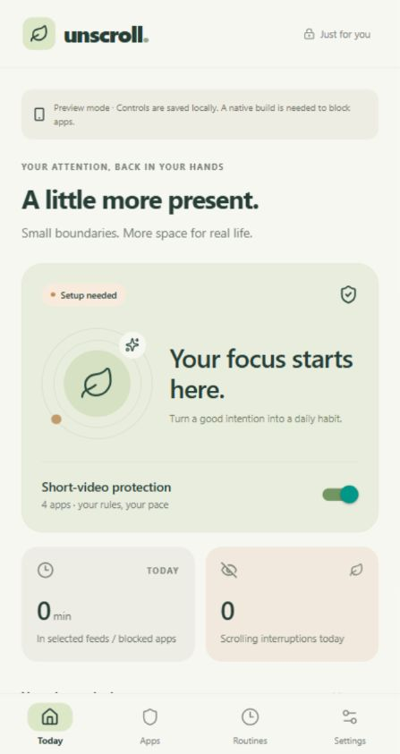
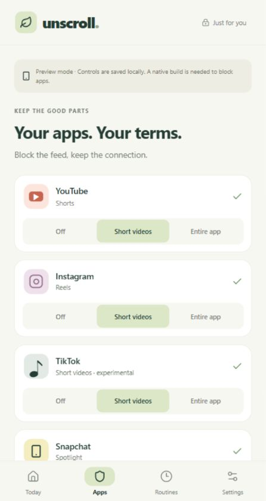
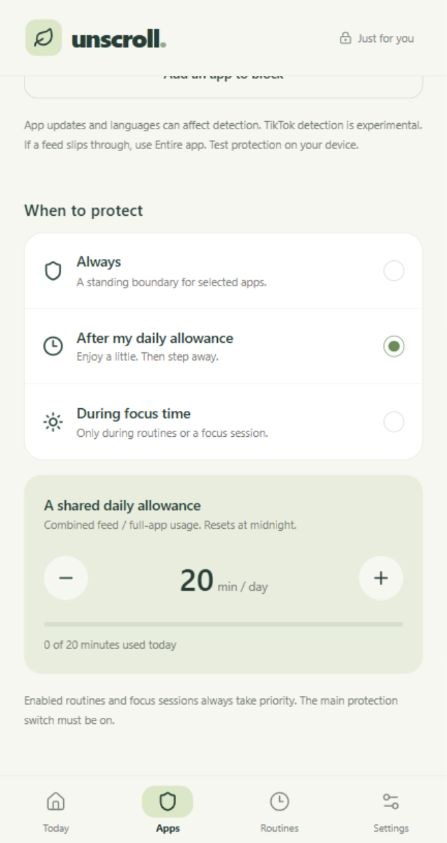
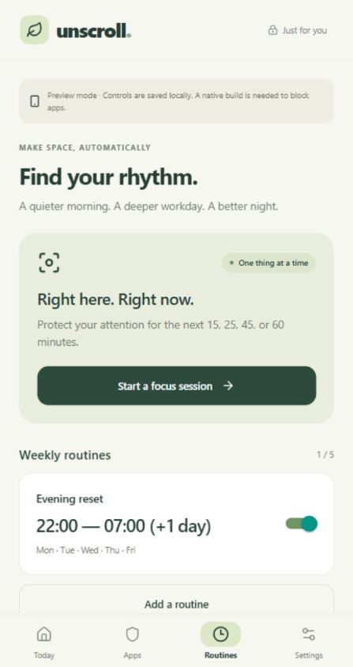
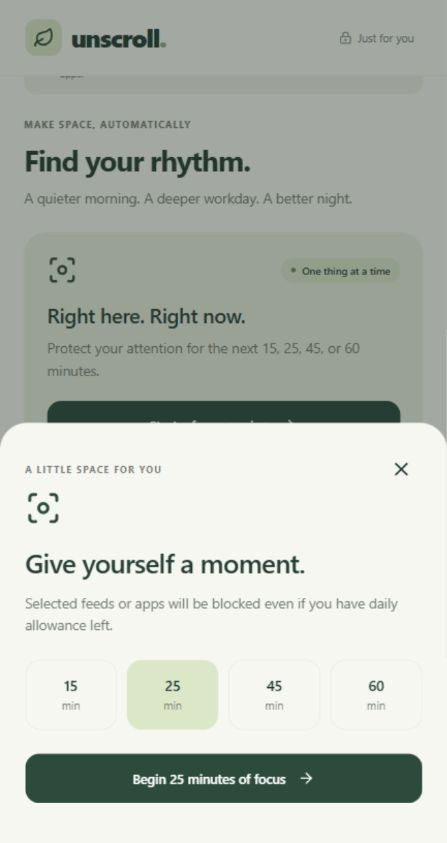
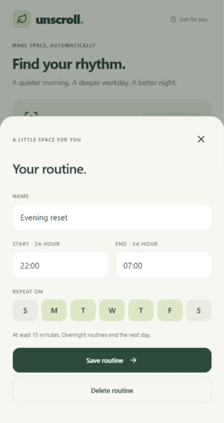
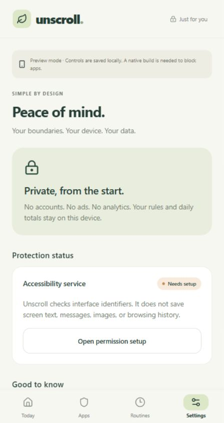
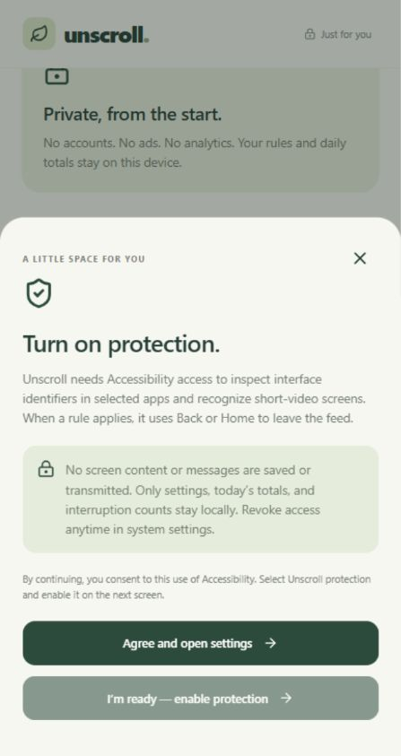

# Unscroll screen designs

These are screenshots of the implemented React Native web preview, captured at a phone-sized viewport. They show the Android-style feature set with sample local settings. They are not proof of native blocking or screenshots from a physical phone. iOS uses whole-app Screen Time controls instead of selective-feed controls.

| Today | App selection |
| --- | --- |
|  |  |

| Daily allowance | Routines |
| --- | --- |
|  |  |

| Focus session | Routine editor |
| --- | --- |
|  |  |

| Settings | Permission disclosure |
| --- | --- |
|  |  |

Download all eight images in [the screen archive](unscroll-ui-screens.zip).
